The SEPAL interface and the SEPAL-SDG 15.4.2
============================================

New SEPAL users are recommended to look over the interface and familiarize themselves with the SEPAL interface, main tools,functionalities and workflows. A detailed description of the features can be consulted in the `SEPAL documentation <https://docs.sepal.io/en/latest/setup/presentation.html#sepal-interface>`_.

Setting up a SEPAL Instance
----------------------------

Some applications in SEPAL make use of instances to run analyses ; running them will use your SEPAL computing resources. Selecting an app automatically initiates the process , starting the smallest instance to run the SEPAL sandbox. However, in some cases, especially where more powerful processing is required, you might need larger instances. For this reason, you may need to manually set up a larger SEPAL instance before running the modules. To set up an instance :

1. Go to the `SEPAL terminal <https://docs.sepal.io/en/latest/setup/presentation.html#terminal>`_ (blue icon in the left panel in the image below) and wait for the instance selector to start.

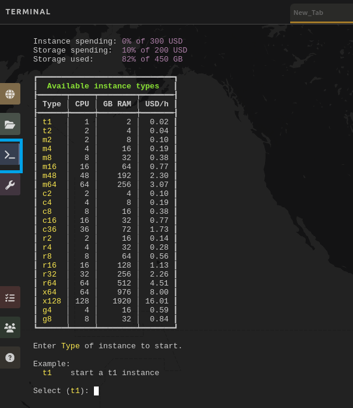

2. Type the instance name e.g. t1 , m2 or m4 then press ENTER.
3. Wait for the instance to finish loading.
4. Once completed, go back to the dashboard of the application to launch your app. It will automatically use the instance you have set.

**SEPAL SDG 15.4.2 doesn't require any additional instances to run**.

Accessing SEPAL-SDG 15.4.2 
----------------------------

To open the SEPAL-SDG 15.4.2 module , click on the **apps tab** and search for the SDG 15.4.2 module among the apps ,alternatively, you can type in the search box "SDG 15.4.2". Click on the app drawer and wait a few minutes for the module to load. 
  
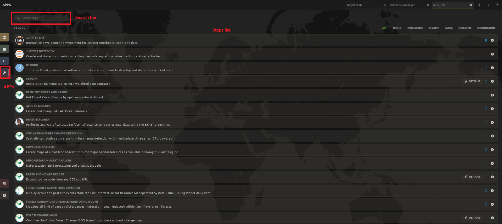

The module's interface is divided into two main sections as shown below:

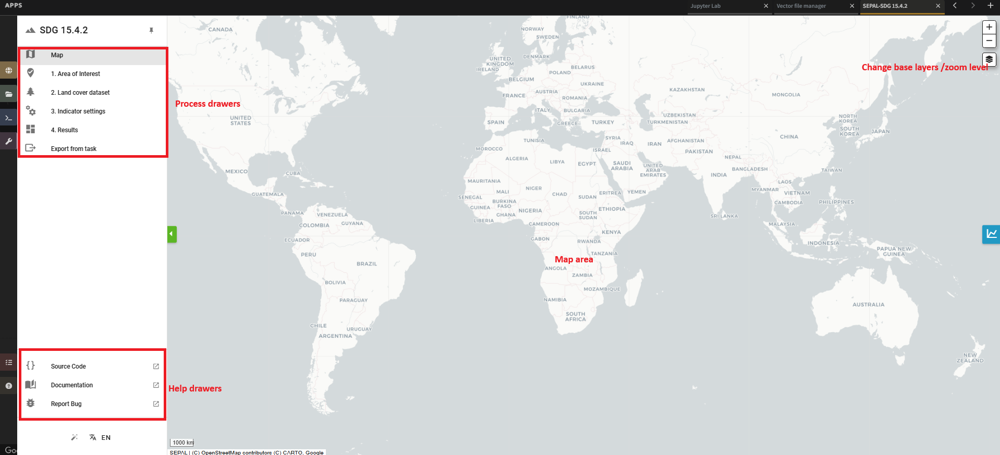

- **Process drawers**: Located on the top left of the interface , the process drawers contain the processing steps to run the module. In SEPAL-SDG 15.4.2 , this is composed by 4 processing steps: Area of interest; Land cover settings; Indicator settings and Results.

- **Help drawers**: Located just below the process drawers , they describe the tool, its objectives and give a background about its development. They also detail the source code (the module was developed under a MIT license, which means that the module is freely accessible, and the code is hosted publicly in GitHub); the Wiki (the latest documentation on tool)  ,the bug report (report of unexpected results or behavior.) and the tasks runner (runs larger processing elements). More on tasks will be elaborated in future sections.

Personalising SEPAL-SDG 15.4.2 
--------------------------------

SEPAL-SDG 15.4.2 allows users to personalize its appearance to suit their preferences.

**Theme customisation:**
Users can choose between a dark or light theme. To change the theme, click the theme icon , located at the bottom left panel , below the help drawers .The application will need to be restarted to apply the changes.

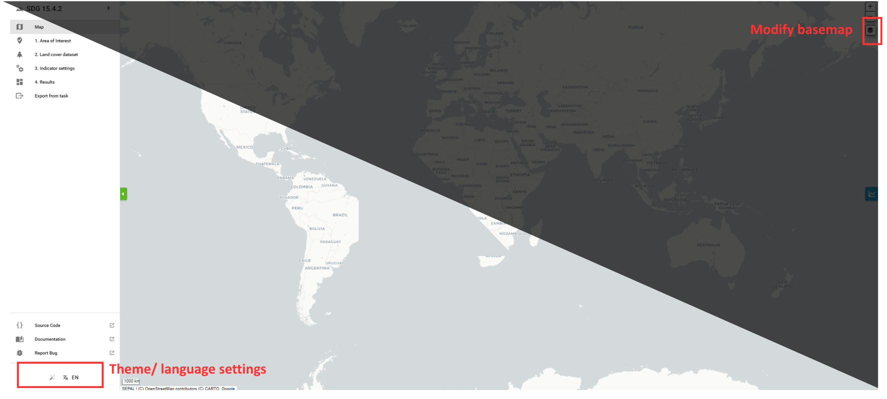

**Language selection:**

SEPAL-SDG 15.4.2 is currently only available in English. New language versions will be made available soon. 

Calculating SDG Indicator 15.4.2
--------------------------------

Conceptual framework
^^^^^^^^^^^^^^^^^^^^
This section covers the  rationale behind SDG Indicator 15.4.2 computation. Simply put ,the indicator monitors mountain ecosystem health by assessing changes in green cover and land cover across mountain bioclimatic belts using four key inputs: land cover data, a digital elevation model, a mountain area map, and a national administrative boundary layer.

Overview of Sub-Indicator 15.4.2a : Mountain Green Cover Index (MGCI)
^^^^^^^^^^^^^^^^^^^^^^^^^^^^^^^^^^^^^^^^^^^^^^^^^^^^^^^^^^^^^^^^^^^^^

**Sub-indicator 15.4.2a, Mountain Green Cover Index (MGCI)**, is designed to measure the extent and changes of green cover - i.e. forest, shrubs, trees, pasture land, cropland, etc. – in mountain areas. MGCI is defined as the percentage of green cover over the total surface of the mountain area of a given country and for given reporting year. The aim of the index is to monitor the evolution of the green cover and thus assess the status of conservation of mountain ecosystems. 

.. math::

   MGCI = \frac{\text{Mountain Green Cover Area}_n}{\text{Total Mountain Area}} \times 100

Where: 

- **Mountain Green Cover Area n** = Sum of areas (in km2) covered by (1) tree-covered areas, (2) croplands,(3) grasslands, (4) shrub-covered areas and (5) shrubs and/or herbaceous vegetation, aquatic or regularly flooded classes in the reporting period n 
- **Total mountain area** = Total area of mountains (in km2). In both the numerator and denominator, mountain area is defined according to UNEP-WCMC (2002).

Overview of Sub-Indicator 15.4.2b : Proportion of degraded mountain land
^^^^^^^^^^^^^^^^^^^^^^^^^^^^^^^^^^^^^^^^^^^^^^^^^^^^^^^^^^^^^^^^^^^^^^^^

**Sub-indicator 15.4.2b, Proportion of degraded mountain land**, is designed to monitor the extent of degraded mountain land as a result of land cover change in a given country and for given reporting year. Similarly to sub-indicator "trends in land cover" under SDG Indicator 15.3.1 (Sims et al. 2021), mountain ecosystem degradation and recovery is assessed based on the definition of land cover type transitions that constitute degradation, as either improving, stable or degraded. The indicator adopts the definition of degradation established by the Intergovernmental Science-Policy Platform on Biodiversity and Ecosystem Services (IPBES) in its computation.

.. math::

   \text{Proportion of Degraded Mountain Land} = \frac{\text{Degraded Mountain Area}_n}{\text{Total Mountain Area}} \times 100

Where:

- **Degraded mountain area n** = Total degraded mountain area (in km2) in the reporting period n. This is, the sum of the areas where land cover change is considered to constitute degradation from the baseline period. Degraded mountain land will be assessed based on the land cover transition matrix in Annex 1.
- **Total mountain area** = Total area of mountains (in km2). In both the numerator and denominator, mountain area is defined according to UNEP-WCMC (2002).

**Disaggregation:**

Both of these sub-indicators are disaggregated by mountain bioclimatic belts as defined by Körner et al. (2011). In addition, land cover in sub-indicator 15.4.2a is
disaggregated into the 10 SEEA classes based on UN Statistical Division (2014).  Those values are reported both as proportions (percent) and area (in square kilometres)

More detailed information on the overall conceptual framework of the indicator is available in the `indicator's metadata <https://unstats.un.org/sdgs/metadata/files/Metadata-15-04-02.pdf>`_.

**To illustrate, we will compute SDG 15.4.2 using Nepal as an example. Throughout the tutorial , we will assume all the default options and datasets available in the application.**

Defining the Area of Interest (AoI)
-----------------------------------

The calculation of the SDG 15.4.2 is restricted to a specific area of interest defined by the user. In this first step, you will have the option to choose between a predefined list of administrative layers or to use a custom dataset to delineate the computational area.

**1. Click on the Area of Interest Drawer to define your AOI.** 

A pop-up will display the following available options to set your AOI: 

- Administrative definitions
- Custom layers

.. image:: ../_static/sepal/updates_26/defining_aoi_options.png
   :align: center
   :width: 400
   :alt: Defining_AOI

**2. The Administrative definitions option presents the default administrative boundary dataset (GAUL,2015). Users have three scale options to choose from ; country , sub-national level 1 (provinces, states or regions) and sub-national level 2 (district , counties or municipalities ).To define the Area of Interest using this option, :**

- Select **Country** under Administrative definitions. 
- In the dropdown list , select the country or territory to calculate SDG Indicator 15.4.2. In this example, we will select Nepal, as shown below.

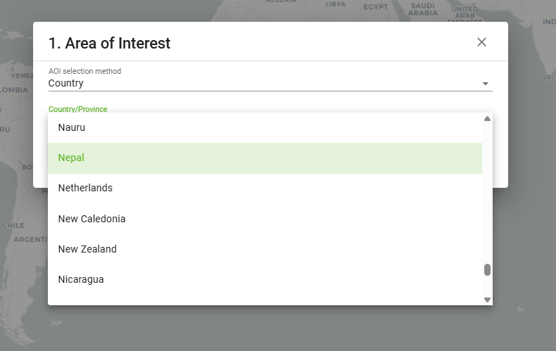

- Clicking on the **Select Area of Interest (AOI)** will display your selection on the map area alongside a corresponding legend.The algorithm automatically generates a legend based on the four mountain bioclimatic belt classes and the area for each as defined in the global mountain map developed by FAO to compute this indicator.

.. image:: ../_static/sepal/updates_26/AOI_display.png
   :align: center
   :width: 600
   :alt: displaying_nepal

.. warning:: The  administrative boundaries available SEPAL-SDG 15.4.2 are extracted from the FAO Global Administrative Unit Layers (GAUL,2015) dataset. The designations employed in the presentation of material on this map do not imply the expression of any opinion whatsoever on the part of the United Nations Secretariat concerning the legal status of any country, territory, city or area or of its authorities, or concerning the delimitation of its frontiers or boundaries. 

**Using Custom Geometries**

**3. The Custom layers option allows users to use their own national administrative boundary layers.** The boundary layer must be a vector file (for example a shapefile or GeoJSON) uploaded to Google Earth Engine (GEE) as an asset to be used. To define the AOI using this method;

- Choose **GEE Asset Name** as your AOI selection method.
- Copy the **Asset ID** in GEE and paste under "Select an asset"
- Specify the column or leave the "Use all features" option to leave the default settings.

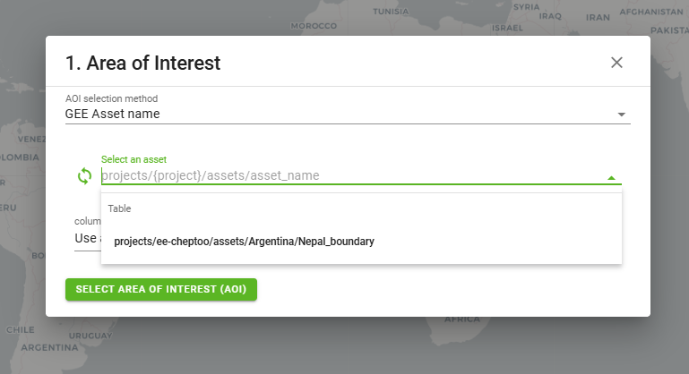

Land Cover Dataset 
-------------------

This section of the documentation covers the configuration of the land cover dataset for the computation of SDG Indicator 15.4.2.

Defining your land cover dataset 
^^^^^^^^^^^^^^^^^^^^^^^^^^^^^^^^^

**1. Click on the Land cover dataset in the process drawers located in the left panel to open the land cover dataset selector, as shown below:**

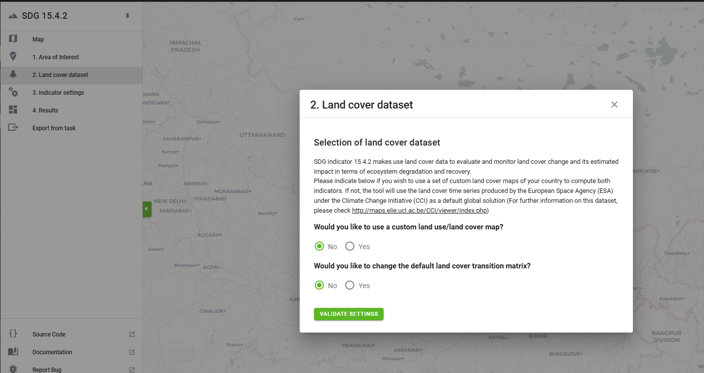

**2. The panel presents two questions:**

**Would you like to use a custom land use/land cover map?**
- Select **Yes** to use national land cover maps to compute both sub-indicators.
- Select **No**  to use the default global land cover time series . 

**Would you like to change the default land cover transition matrix?**

- Select **Yes** to use a custom land cover transition matrix to compute sub-indicator B. 
- Select **No** to use the default transition matrix (UN-SEEA classes derived).

We will look at each scenario individually:

Using the Default Land cover Maps
~~~~~~~~~~~~~~~~~~~~~~~~~~~~~~~~~

When custom national land cover maps are not available, national agencies can use the default land cover dataset available in SEPAL-SDG 15.4.2.

After clicking on **No** to the first question,you have a choice to modify the land cover transition matrix or use the default one.If using the default one, click **No** to the transition matrix question and proceed to the :ref:`Defining the Indicator Settings Chapter <Indicator Settings>`

In the case where national agencies want to modify the land cover transition matrix,the process is described :ref:`here <Defaultlccustommatrix>`.

Using Custom Land cover maps
~~~~~~~~~~~~~~~~~~~~~~~~~~~~
- Select **Yes** to the first question. Then click on **Open Parameters Settings** .

- This opens a new pop-up window that allows you to select your land cover maps as a GEE asset (remember that they must be stored as a `GEE image collection <https://developers.google.com/earth-engine/guides/ic_creating>`_ to be imported.Individual images will not be recognized by the app). Use the bottom arrow to choose your asset or copy/paste it directly from GEE. Then click on **Get classes**

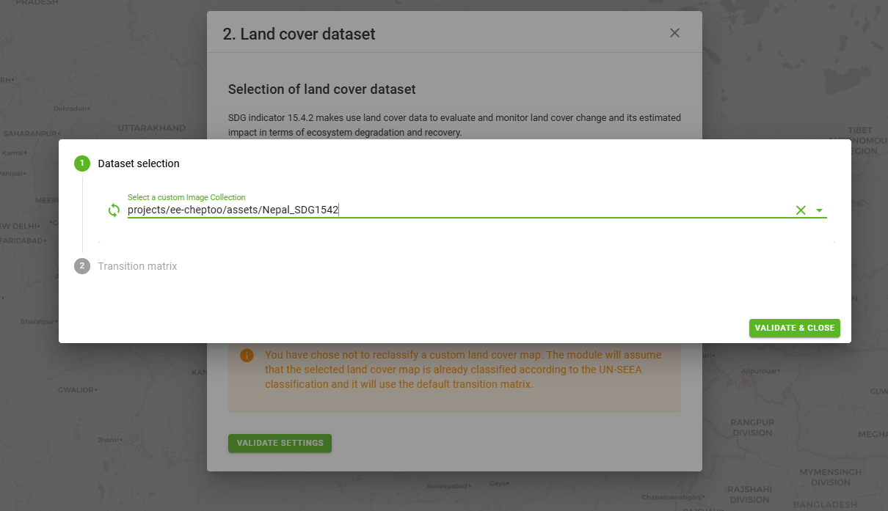

.. note:: Choosing Yes in the first question and No in the second, will have the model assume that the selected land cover map is already classified according to the UN-SEEA classification and it will use the default transition matrix. In some cases, national authorities might opt to use the default land cover map but still define a custom transition matrix to capture local degradation characteristics. More on this will be described in the next section.

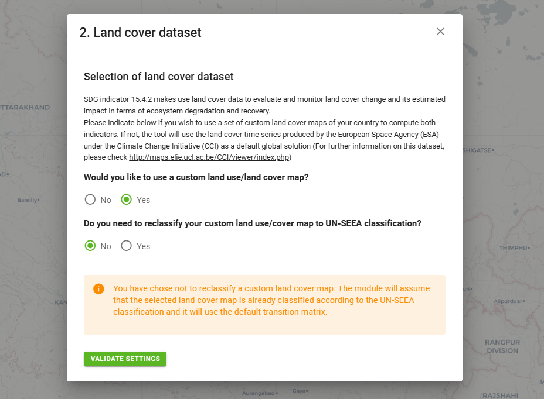

**3. For the case of Nepal, we will use the default land cover map and transition matrix. Therefore, we select** **No** **to both questions, then click on** **Open Parameters Settings** **to proceed.**

Reclassifying the land cover map legend for sub-Indicator A computation.
^^^^^^^^^^^^^^^^^^^^^^^^^^^^^^^^^^^^^^^^^^^^^^^^^^^^^^^^^^^^^^^^^^^^^^^^

.. important:: The UN-SEEA land cover classification is the default classification scheme adopted for this sub-indicator. National agencies must adapt their land cover classes to match the UN-SEEA one for sub-indicator A computation.

Reclassification can be done in two different ways; By manually assigning your source and target land classes or by uploading a reclassification matrix.

Using a reclassification matrix
~~~~~~~~~~~~~~~~~~~~~~~~~~~~~~~~

.. _reclass_table:

  .. tip:: What is a reclassification matrix table?

     A reclassification matrix is a comma-separated values (CSV) file used to reclassify old pixel values into new ones. The CSV file only has to contain two values per line, the first one refers to the `from` value, while the second is the `target` value, just as it is described in the following table: 

      .. csv-table:: Reclassification table example
         :header: "Origin class", "Target class"
         :widths: auto
         :align: center

         "311", "1"
         "111", "5"
         "...","..."
         "511", "4"

Uploading a reclassification matrix
~~~~~~~~~~~~~~~~~~~~~~~~~~~~~~~~~~~

- To upload a custom reclassification matrix, click on the arrow icon :guilabel:`⬆`  in the top right corner of the reclassification pop-up window(see the image above).
- The table must be in :code:`.csv` , indicating the SEEA land cover equivalent to your land cover classes .Remember the table must already be uploaded in your SEPAL environment. To learn how to do that, please see the `how to exchange files in SEPAL <https://docs.sepal.io/en/latest/setup/filezilla.html#exchange-files-with-sepal>`_. 

.. tip:: The target values must match the UN-SEAA classes codes for sub-indicator A (click on the info button at the top of the table for information on how the SEEA classes are coded).

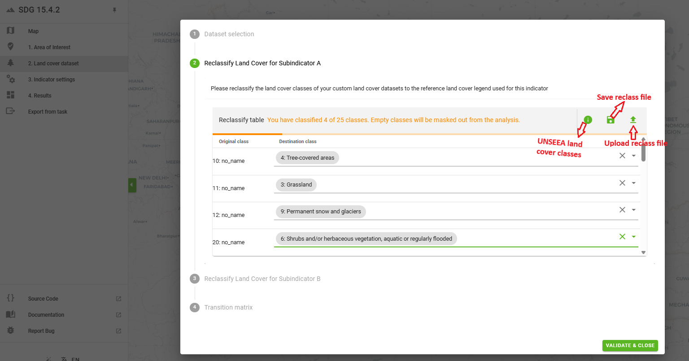

- Clicking on **load** will automatically reclassify your land cover legend.

**In certain cases, certain land cover classes might be classified as No Data, Missing Values or Unclassified .In such cases leaving the classes blank will be interpreted as 0 values by SEPAL SDG 15.4.2 and consequently not included in the computation. Note: Any values left blank will be interpreted as 0**.

.. important:: For ease and comparability when developing a reclassification matrix, the development team have created a template countries can modify for their use. The template can be found in the :ref:`Annex section <Annex>`.

Manually Reclassifying the land classes 
~~~~~~~~~~~~~~~~~~~~~~~~~~~~~~~~~~~~~~~~
- Directly specify the reclassification rules by matching each land cover class (original class column) to its SEEA equivalent (destination class column), as shown below. Click the information icon in the upper right of the tools ribbon to reference the UN-SEEA classes if needed..
- Select the :guilabel:`💾` button located at the top of the table to save the table within SEPAL for future calculation.

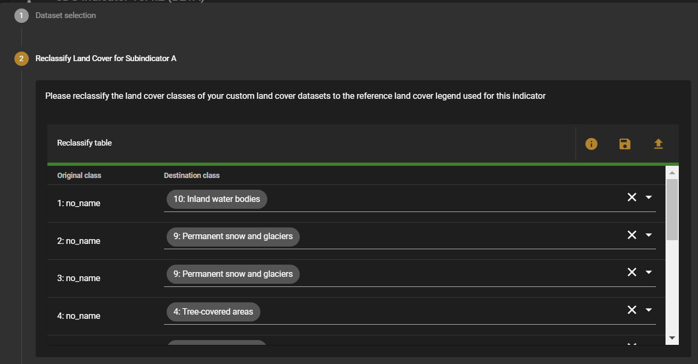

For our example, we will reclassify Nepal’s national land cover class using the following guide:

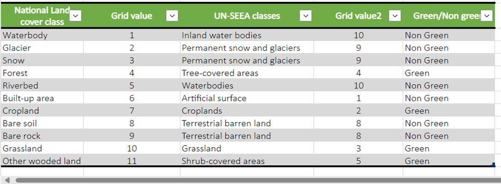

-Once all land classes have been reclassified , click on **Reclassify Land Cover for sub-indicator B** in the process drawer to proceed.

Reclassifying your land cover map legend for sub-Indicator B computation.
^^^^^^^^^^^^^^^^^^^^^^^^^^^^^^^^^^^^^^^^^^^^^^^^^^^^^^^^^^^^^^^^^^^^^^^^^
This step allows you to reclassify the legend of your land cover map for computing Sub-Indicator B. 

.. note:: In contrast to sub-indicator A, national authorities have the liberty to use alternative land cover legends in the place of the default 10 UN-SEEA classes. Consequently ,the UN-SEEA legend can be adapted to the national context to ensure that it adequately captures the key degradation and improvement transitions identified in the country . For instance, a given country may decide to differentiate "natural forests" from "tree plantations" in sub-indicator B.

For this reason, this step allows users to apply a new reclassification, or alternatively, use the same reclassification rules defined in Sub-Indicator A. In the latter case,you can access the the reclassification matrix you created and saved earlier by clicking the upload button amnd choosing the file. For both cases, the land cover reclassification rules must be a :code:`.CSV` file, following the same method as in the prior step.

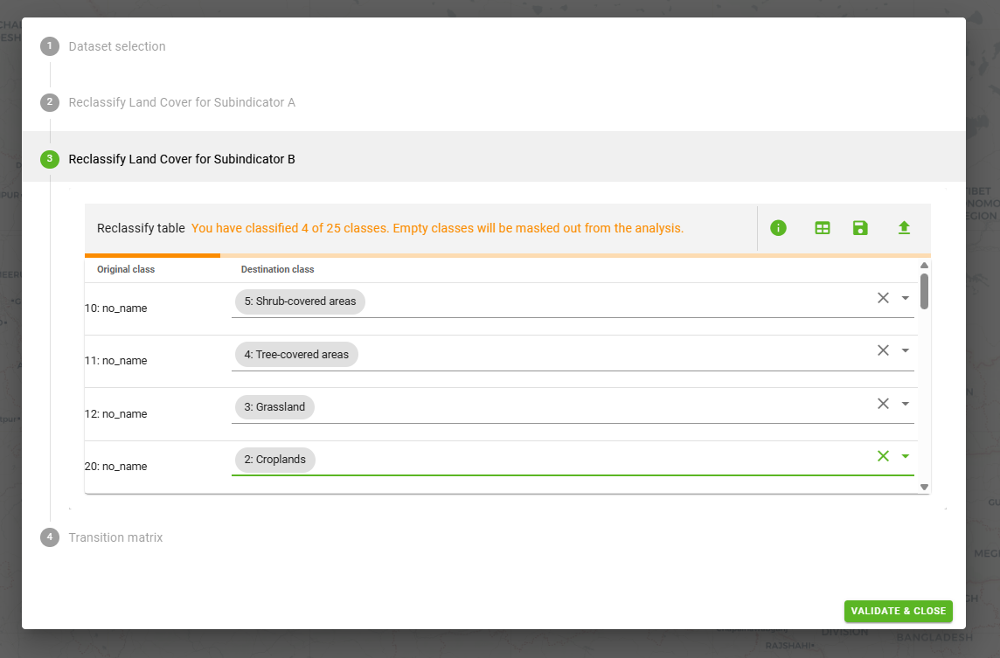

Check the :ref:`Annex <Annex>` for a template that can be modified for your land cover legend.

Uploading a transition matrix for computing Sub-Indicator B
^^^^^^^^^^^^^^^^^^^^^^^^^^^^^^^^^^^^^^^^^^^^^^^^^^^^^^^^^^^

.. important:: **This step should only be completed if you have provided different land cover reclassification rules for Sub-Indicator B in the prior step.** 

The next step is to upload a land cover transition matrix, defining the transitions between the land cover classes .We will consider the transitions to be either **degraded** , **stable** or **improved** , consistent to the legend you have provided in the prior step. This will allow SEPAL-SDG 15.4.2 to compute this sub-indicator in the next processing steps. 

As mentioned earlier , the transition file should have been previously uploaded in the SEPAL environment as a csv file, containing the following columns: **from_code**, **to_code**, **impact_code** and **impact_name** .The column names must match exactly. (indication of change between the land cover classes)

Check the :ref:`Annex <Annex>` for the transition matrix template.

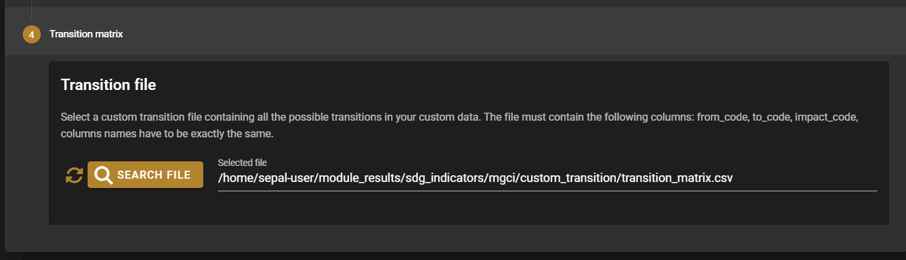

.. _Defaultlccustommatrix:

Modifying the default transition matrix for use with global land cover data
^^^^^^^^^^^^^^^^^^^^^^^^^^^^^^^^^^^^^^^^^^^^^^^^^^^^^^^^^^^^^^^^^^^^^^^^^^^

SEPAL-SDG 15.4.2 allows users to modify the default land cover transition matrix without providing a custom land cover map. This enables national authorities to adapt the transition matrix to their local context, better capturing the main land degradation processes occurring in the country while continuing to use the default global land cover data.

- This can be done by selecting **No** to the first question  and **Yes** to the second question of the land cover dataset questionnaire, and then clicking on **Open Parameter Settings**.

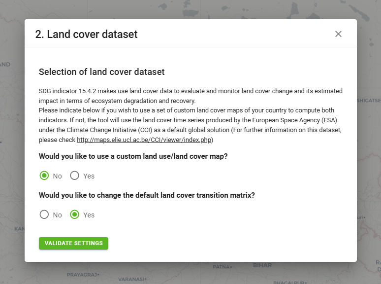

- This will open a pop-up window including the default land cover transitions matrix, showing positive land cover transitions in green, negative in red, and stable/neutral transitions in blue. The matrix can be directly modified by clicking on each cell and changing the sign of the transition.

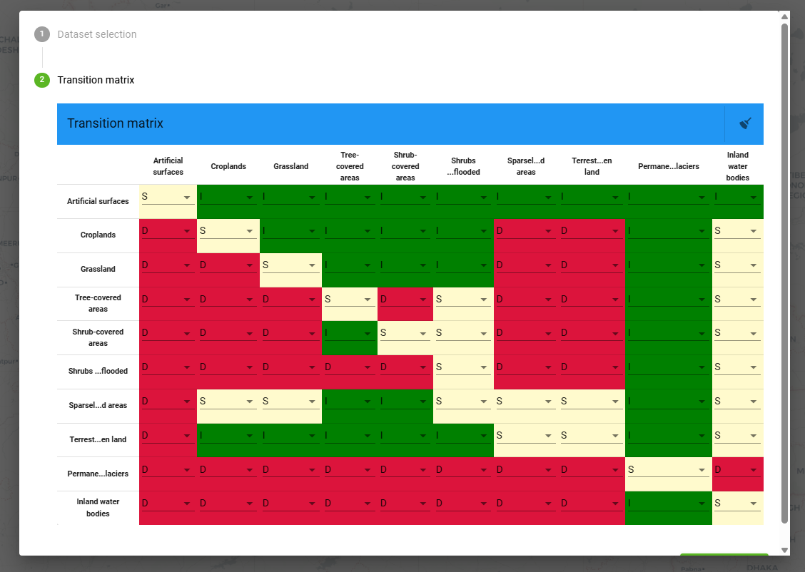

- Once finished, click outside the window to move to the next processing step: **Indicators Settings.**

.. warning::
   Adapting the default land cover transition matrix when using the default global land cover data should be carefully considered. Decisions about which land cover transitions are linked to a degradation or an improvement process in the context of sub-indicator B should be made taking into account the expected change in biodiversity and the mountain ecosystem functions or services that are considered desirable in a local or national context. For these reasons, FAO recommends to consider as degradation all land cover transitions that involve changes from natural land cover types (such as forests, shrublands, grasslands, wetlands) to anthropogenic land cover types (artificial surfaces, cropland, pastures, plantation forests, etc.) as a general rule, given that land use change is known to be the primary driver of biodiversity loss (IPBES, 2019).

.. _Indicator Settings:

Indicators Settings
-------------------

Once the area of interest, land cover data, reclassification rules, and transition matrix have been configured,  click the **Indicator Settings**  in the process drawers to set the parameters required for the computation of both sub-indicators.

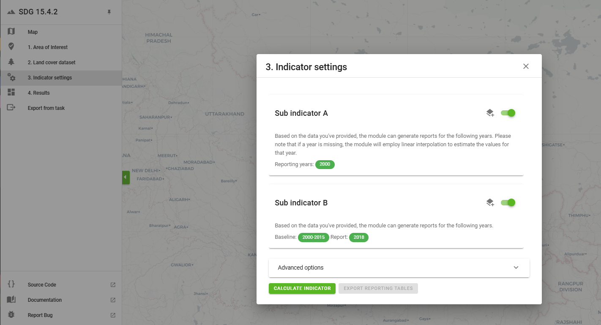

From here on, we will cover the sub-indicators individually.

Defining parameters for Sub-indicator A: Mountain Green Cover Index
^^^^^^^^^^^^^^^^^^^^^^^^^^^^^^^^^^^^^^^^^^^^^^^^^^^^^^^^^^^^^^^^^^^
**1. Click on the add layer icon (highlighted in red) to define the computational years**

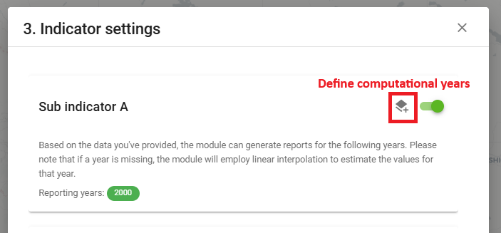

**2. In the pop-up window, link each land cover map — whether default or custom — to its corresponding reference year. You can report on one or multiple years. To add additional reporting years, click the + button** 

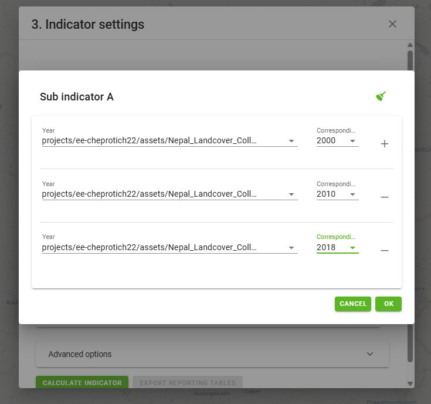

.. note::  The reporting years for sub-indicator A are every five years from the baseline i.e. 2000, 2005, 2010, 2015 and subsequently every three years (2018, 2021, 2024,...).If your custom national land cover maps are not annually updated and do not exactly match the reporting years — for example, if you have a land cover map for 2004 instead of 2005 — the tool will automatically interpolate values for the missing reporting years based on the available land cover data.

**3. Click OK. The list of reporting years will now be listed at the bottom of the sub-indicator A box.**

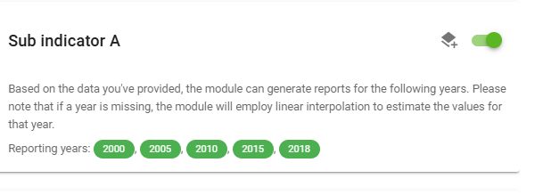
 

Defining parameters for Sub-Indicator B: Proportion of Degraded Mountain Land.
^^^^^^^^^^^^^^^^^^^^^^^^^^^^^^^^^^^^^^^^^^^^^^^^^^^^^^^^^^^^^^^^^^^^^^^^^^^^^^
Unlike sub-indicator A, sub-indicator B first calculates the extent of degraded mountain land during the baseline period 2000–2015. This baseline sets the benchmark against which land degradation is measured and monitored every three years from 2015 onwards. In each subsequent reporting period (2018, 2021, 2024, ...), newly degraded land is added to the baseline estimate to track the cumulative extent of land cover degradation over time. For this reason, the tool automatically applies 2000–2015 as the baseline period.

**1. Define the land cover maps for the baseline years 2000 and 2015 by linking each of the land maps to their corresponding reference year. If your custom national land cover maps do not exactly match the baseline reporting years, select the map whose reference year is closest to the required reporting year. For example, a land cover map for 1998 could be used for the reporting year 2000.**

**2. Then define the land cover maps for each of the reporting years and click** **OK** **to compute.**

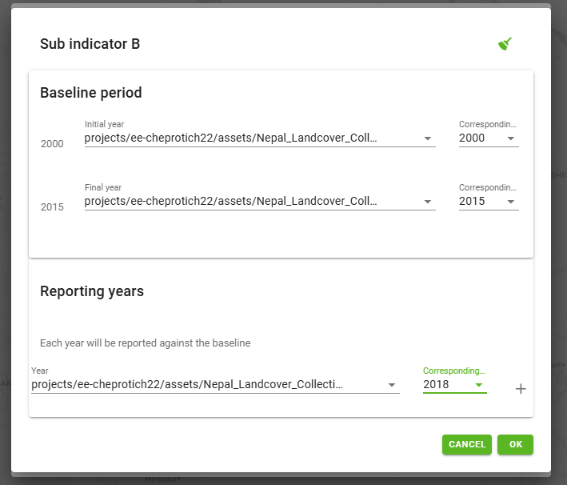

Calculation of SDG Indicator 15.4.2
-----------------------------------
Once the parameters of each sub-indicator are set, the tool is now ready to run as shown below:

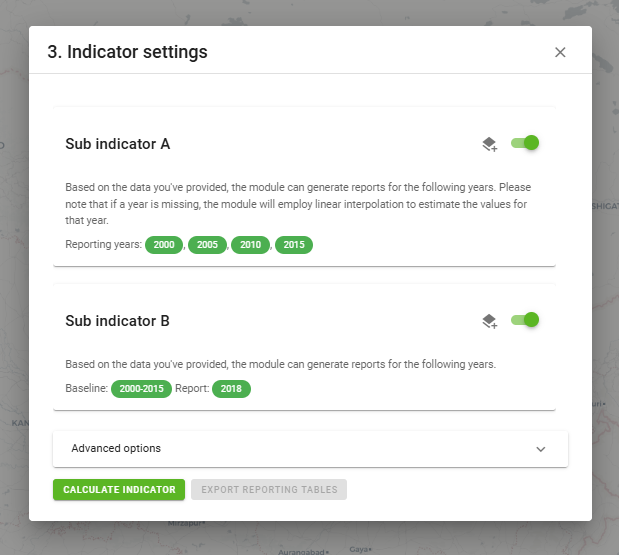

.. tip::

   By default, SEPAL-SDG 15.4.2 calculates indicator values assuming planimetric area methods. To calculate indicator values using the real surface area method (a method that takes into account the third dimension of mountain surfaces through the use of digital elevation models and is known to derive closer estimates of the real surface area of mountain regions), click on "Use Real Surface Area" in the Advanced options . Additionally , users can direct computation in Earth Engine (Run in EE background) or modify the processing scale by defining them in the Advanced Options as well.

   .. image:: ../_static/sepal/updates_26/advanced_options.png
      :align: center
      :width: 400
      :alt: Sub-indicator computations.

**1. Click on** **Calculate Indicator** **to initiate the computation.**

**2. Once completed, the module should display the following:**

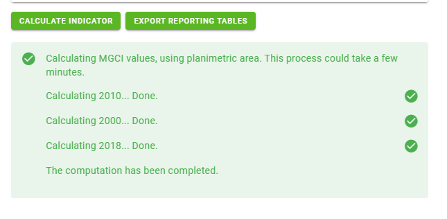

.. tip::

   SEPAL-SDG 15.4.2 calculates the indicator values assuming planimetric area methods by default. To calculate indicator values using the real surface area method (a method that takes into account the third dimension of mountain surfaces through the use of digital elevation models and is known to derive closer estimates of the real surface area of mountain regions), click on **Use Real Surface Area**

3. The entire analysis is done in real time. To export the results, click **Export Reporting Tables**, a message will appear indicating the location of the exported files once complete.

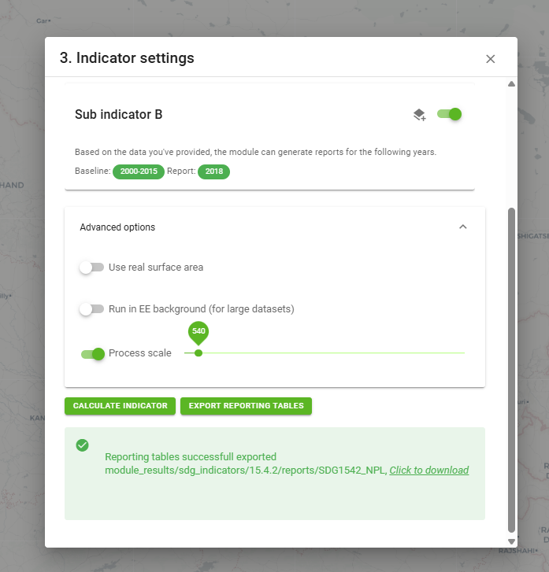

Calculation from Task
^^^^^^^^^^^^^^^^^^^^^
As explained in earlier sections, SEPAL runs on Google Earth Engine (GEE), and as a result, the computation of SDG Indicator 15.4.2 is subject to GEE resource limitations. One such limitation is the computation timeout (see `computation time out <https://developers.google.com/earth-engine/guides/debugging#timed-out>`_) ,whereby any computation that takes more than five minutes will throw an exception. To overcome this, the process will be automatically executed as a GEE task —an operation capable of running beyond the standard timeout limit. If the computation is submitted as a task, a message similar to the one shown in the image below will appear.

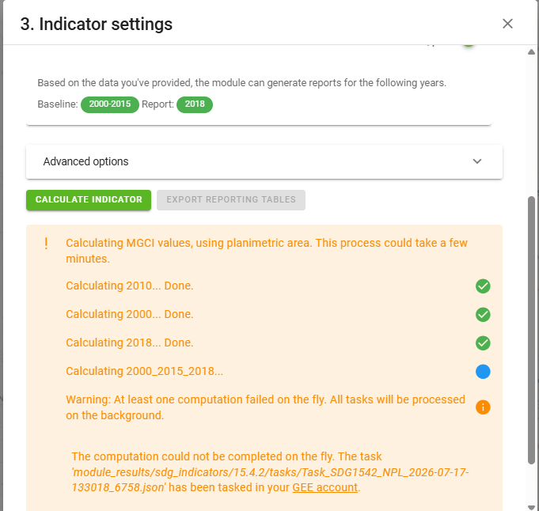

A new file containing the task ID is created and stored in the ../module_results/sdg_indicators/mgci/tasks folder. This file allows you to track the status of the task at any time. Alternatively, you can monitor progress using the GEE task tracker (shown above), which displays all tasks currently running on the server.

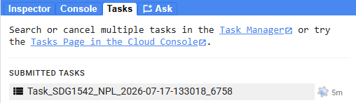

**1. To enable a computation from task; Click the "Export from task" in the process drawer.**

We start by locating the tasking file within SEPAL using the navigator , initiated by clicking on the select file button, and then  Download and Export Tables button .The computation then proceeds as normal , displaying the results dashboard once completed. To locate the tasks manually, navigate to the File Layer > Downloads > Module results> Tasks as shown below.

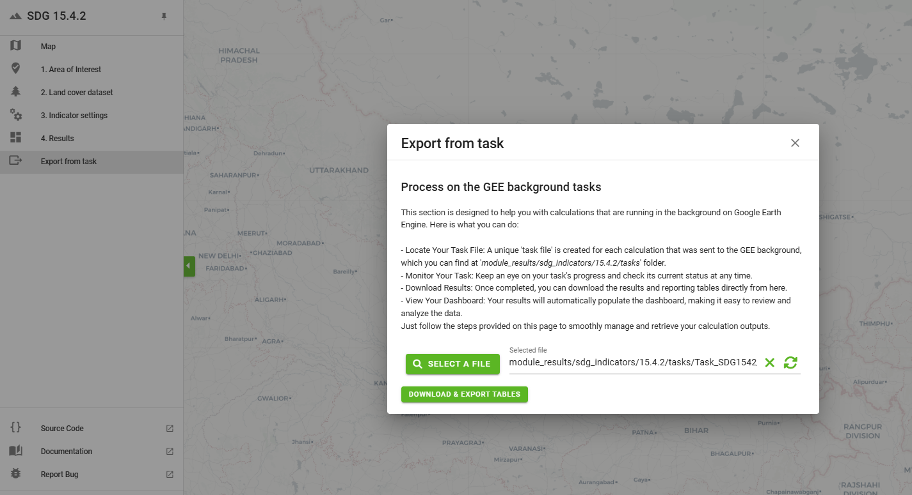

Visualising the results
-----------------------

SEPAL-SDG 15.4.2 provides two ways to visualise and access the computed results : 

- The exported tables: These provide the full results of the computation in a tabular format.

- Using the MGCI results drawer that provides a simplified and visual representation of the results.

We will look at these individually.

Exported tables
^^^^^^^^^^^^^^^

Once the computation is complete, the results are automatically saved to the SEPAL workspace. Users can also download the files to their local computers for offline access or external reporting purposes.

**1. To locate the tables within SEPAL, navigate to the Files Tab, located in the left panel. Navigate to Module results > sdg_indicators > 15.4.2 > reports, you should see your table under MGCI reports as shown below:**

**2. To download the report from the SEPAL workspace, click on the report to activate the download icon, found in the top left side of the screen.**

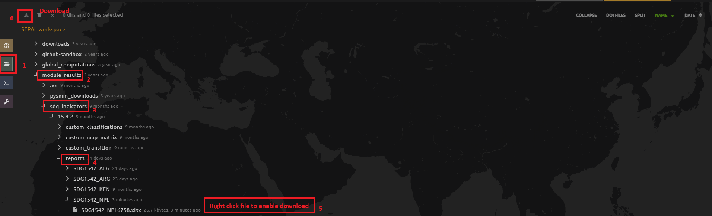

**3. Once the report is downloaded, you can visualise the results of the computation as seen below:**

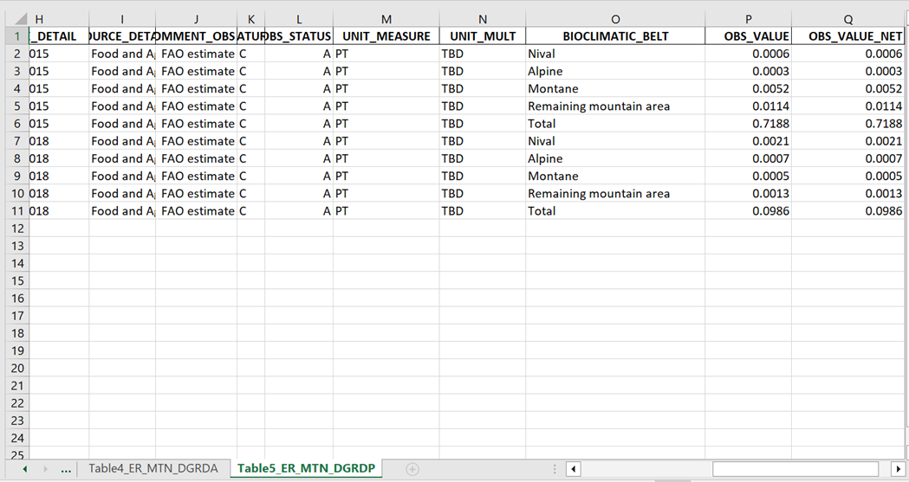

.. tip:: The tables follow the standard format for SDG reporting and therefore can be used to report SDG Indicator 15.4.2 values to FAO.

Visualising the results through the MGCI Results Drawer
^^^^^^^^^^^^^^^^^^^^^^^^^^^^^^^^^^^^^^^^^^^^^^^^^^^^^^^

SEPAL-SDG 15.4.2 also allows users to visualise the computed results directly within the module. Interactive dashboards are generated to display the results for both sub-indicators . Additionally users can add layers to the map  and download needed layers . To navigate the results panel ,

**1. Click on the "Results" located in the process drawer on the left, to open the Results panel.**

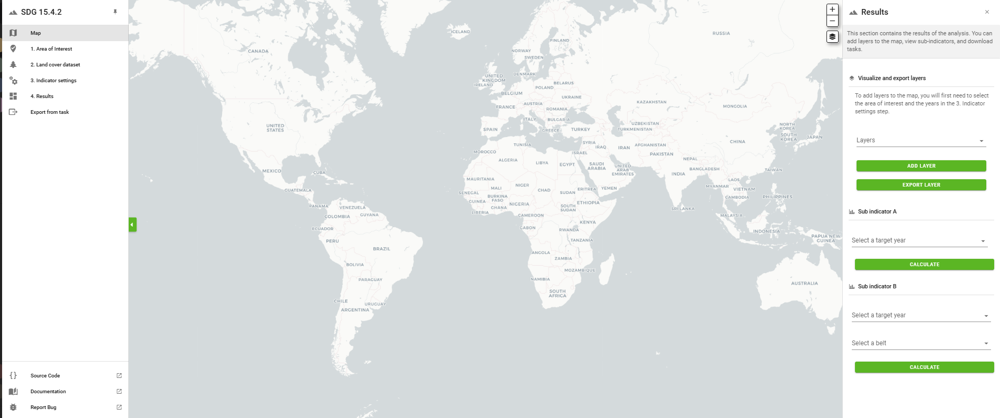

**2. To map the computational layers including the disaggregated land cover maps, select a layer from the Layer List, then click on "Add Layer."**

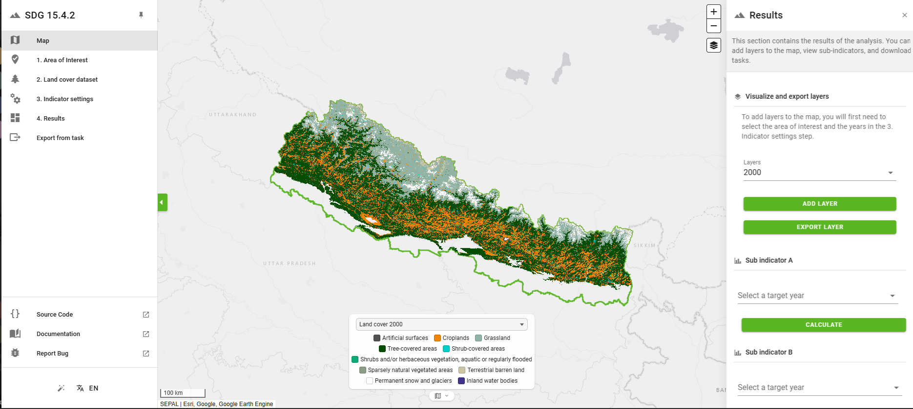

**3. To download a layer, choose the layer of interest in the layer list, then click on "Export Layer."**

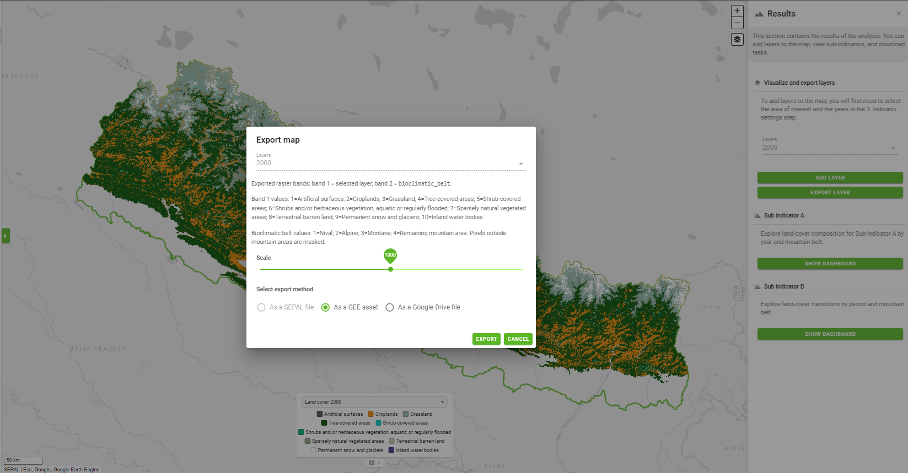

**4.  Click on "Show Dashboard" under Sub-indicator A to display the Mountain Green Cover Index (MGCI) for each reporting year,disaggregated by bioclimatic belts, together with the land cover composition.**

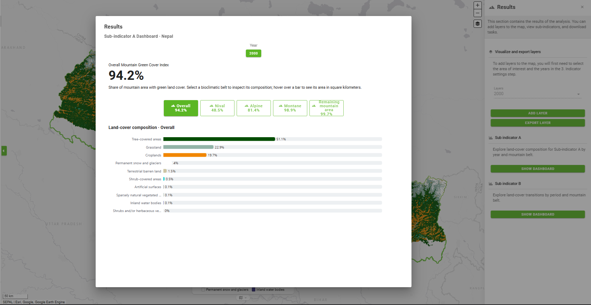

**5. Sub-indicator B uses a Sankey diagram to show the transitions between land cover classes, in km\ :sup:`2`, for the each computed year and bioclimatic belt. Hovering over the sankey will display area changes.**

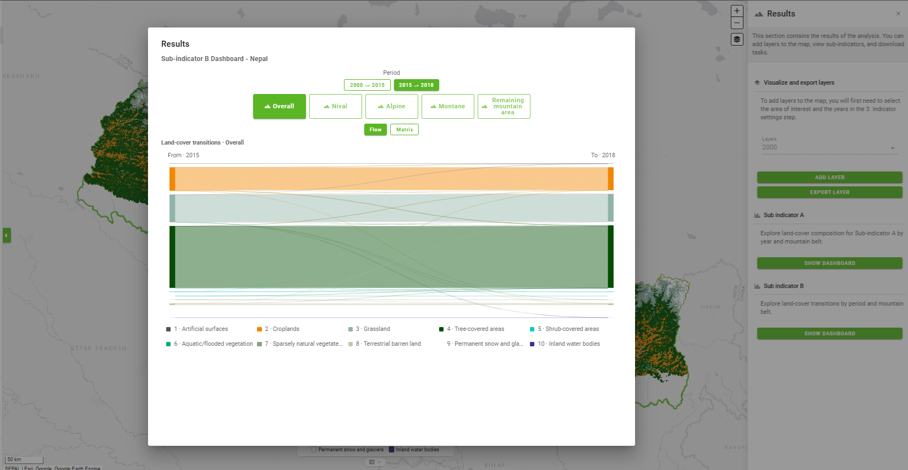

  
.. _Annex:

Annex
-----

This section contains supplementary information and resources for an 
enhanced understanding and operationalization of SEPAL-SDG 15.4.2.

Computation Resources: Template Tables
^^^^^^^^^^^^^^^^^^^^^^^^^^^^^^^^^^^^^^^

.. tip:: 
   
   All templates contain a README section with instructions.

Template A: Custom Land Cover Reclassification Template
~~~~~~~~~~~~~~~~~~~~~~~~~~~~~~~~~~~~~~~~~~~~~~~~~~~~~~~~

When computing sub-indicator A using **custom** land cover maps, SEPAL-SDG 15.4.2 requires reclassifying the land cover legend into the 
UN-SEEA classification.

The development team recommends that countries adopt this template to 
reclassify their land cover maps.

.. note::
   
   The origin and target names and codes must be properly defined for 
   the reclassification to work correctly.

The table requires the following fields as columns:

- **from_name**: Name of each land cover class in the custom land cover map.
- **from_code**: Numerical code (pixel value) of each land cover class in 
  the custom land cover map.
- **to_name**: Name of the corresponding UN-SEEA land cover class.
- **to_code**: Numerical code of the corresponding UN-SEEA land cover class.

Download the template here:

.. raw:: html

   <a target="_blank" href="../_static/sepal_tables/Custom_LC_Classification_SubB.csv" download="_static/sepal_tables/Custom_LC_Classification_SubB.csv">Custom_LC_Classification_SubB</a>

Template B: Custom Land Cover Classification Template (Sub-indicator B)
~~~~~~~~~~~~~~~~~~~~~~~~~~~~~~~~~~~~~~~~~~~~~~~~~~~~~~~~~~~~~~~~~~~~~~~~

As explained earlier, countries must use the UN-SEEA defined classes in 
sub-indicator A but have more flexibility when defining the classification 
scheme for sub-indicator B.

Countries can choose to use either the UN-SEEA classification legend 
(defined in the earlier step) or the FAO-defined template to develop their 
classification and legend.

Download the template here:

.. raw:: html

   <a target="_blank" href="../_static/sepal_tables/Default_LC_map_reclassification.csv" download="_static/sepal_tables/LC_map_reclassification.csv">LC_map_reclassification</a>

Template C: Transition Matrix
~~~~~~~~~~~~~~~~~~~~~~~~~~~~~

This template should be used when a custom land classification legend is 
applied in the Sub-Indicator B computation. It enables countries to fully 
capture the transitions occurring in land cover.

.. note::
   
   When adopting this template, remember to fully define the original and 
   resultant classes, the impact, and their subsequent codes so that transitions are correctly captured by SEPAL-SDG 15.4.2.

The following fields must be defined:

- **from_name**: Name of the original land cover class.
- **from_code**: Numerical code (pixel value) of the original land cover class.
- **to_name**: Name of the final land cover class.
- **to_code**: Numerical code (pixel value) of the final land cover class.
- **impact_name**: Expected impact of the land cover transition. Only three 
  values are allowed: *degraded*, *stable*, or *improved*.
- **impact_code**: Numerical code for the expected impact. Only three values 
  are allowed: **1** for degraded, **2** for stable, **3** for improved.

Download the template here:

.. raw:: html

   <a target="_blank" href="../_static/sepal_tables/Transition_Matrix_SubB.csv" download="_static/sepal_tables/Transition_Matrix_SubB.csv">Transition_Matrix_SubB</a>

.. note:: 
   
   SEPAL-SDG 15.4.2 only accepts :code:`.csv` files. Once 
   these templates are modified to meet each country's needs, they must be 
   saved as :code:`.csv` files and imported into the SEPAL environment as 
   described in earlier sectionble*, or *improved*.
- **impact_code**: Numerical code for the expected impact. Only three values 
  are allowed: **1** for degraded, **2** for stable, **3** for improved.

Download the template here:

.. raw:: html

   <a target="_blank" href="../_static/sepal_tables/Transition_Matrix_SubB.csv" download="_static/sepal_tables/Transition_Matrix_SubB.csv">Transition_Matrix_SubB</a>

.. note:: 
   
   SEPAL-SDG 15.4.2 only accepts :code:`.csv` files. Once 
   these templates are modified to meet each country's needs, they must be 
   saved as :code:`.csv` files and imported into the SEPAL environment as 
   described in earlier sections.