Module Requirements
===================

Initial Setup
^^^^^^^^^^^^^
SEPAL is closely linked to Google Earth Engine (GEE), a Google-powered Earth-observation cloud-computing platform, as it is built leveraging many of its functionalities. Therefore, to run SEPAL-SDG 15.4.2 , you will need to have **connected SEPAL and GEE accounts**. 

- To **Create a SEPAL account** please follow the `registration steps described here <https://docs.sepal.io/en/latest/setup/register.html#sign-up-to-sepal>`_ and then familiarize yourself with the tool by exploring its interface.
- To **Create a Google Earth Engine (GEE) account** please follow these `steps <https://docs.sepal.io/en/latest/setup/gee.html#create-a-gee-account>`_ and don't forget to `initialize the home folder <https://docs.sepal.io/en/latest/setup/gee.html#initialize-the-home-folder>`_.
- To **Connect your SEPAL and GEE accounts** follow the `instructions described here <https://docs.sepal.io/en/latest/setup/gee.html#connection-between-gee-and-sepal>`_.

Data Requirements
^^^^^^^^^^^^^^^^^
SDG Indicator 15.4.2 requires several spatial data inputs to be computed. These include:

- **A Mountain Area Map** 
  
For standardization and international comparability of indicator values, SDG Indicator 15.4.2 adheres to the UNEP-WCMC mountain definition (UNEP-WCMC, 2002). The UNEP-WCMC method defines total global mountain area as the sum of seven classes (commonly known as ‘Kapos mountain classes’), based on elevation, slope and local elevation range parameters. This mountain area is subdivided into bioclimatic belts (Nival, Alpine, Montane, and Remaining Mountain Area) based on average temperatures as defined by Körner et al. (2011). A global mountain area map based on these definitions and methodologies has been developed by FAO and is used by default by SEPAL-SDG 15.4.2 in the computations. 

- **A National Administrative Boundary for the country of interest** 
  
SEPAL-SDG 15.4.2 has been designed to facilitate the computation of SDG Indicator 15.4.2 at national level. The FAO Global Administrative Unit Layers (GAUL) 2015 data set is the default source for national boundaries. Alternatively, national agencies can use their own national country boundary layer if available. 

- **A collection of Land Cover Maps for the country of interest** 
  
Land cover maps spatially represent the physical coverage of the Earth's surface categorized into different types (classes) e.g. forests, grasslands, croplands, lakes, wetlands. This data serves different functions for SDG Indicator 15.4.2: 
  
- **In Sub-Indicator 15.4.2a**, land cover is used to categorize land into green and non-green cover areas. 
  
- **In Sub-Indicator 15.4.2b**, land cover is used to identify areas where changes in the type of land cover may indicate a decline or loss of biodiversity, mountain ecosystem functions or services that are considered desirable in a local or national context. 
 
The collection of land cover maps to compute this indicator should be available from the year **2000**. Similar to the national administrative boundary dataset, SEPAL-SDG 15.4.2 provides the default land cover maps to compute the indicator (see Data Sources section). Additionally, it allows national authorities to use relevant national or regional land cover datasets. These datasets should also be available as GEE assets as an `image collection <https://developers.google.com/earth-engine/guides/ic_creating>`_ in order to allow SEPAL-SDG 15.4.2 to access them. The next section of the tutorial will explain how this is done.  

Uploading files into Google Earth Engine
^^^^^^^^^^^^^^^^^^^^^^^^^^^^^^^^^^^^^^^^
GEE allows users to upload several types of data including shapefiles, raster images, image collections, and CSV tables. This section explains how to upload each of these into the platform.

1. To upload files,go to the **Assets** tab in the top-left panel in the **Earth Engine Code Editor** page. Clicking on it will open the **Asset Manager** as shown below:

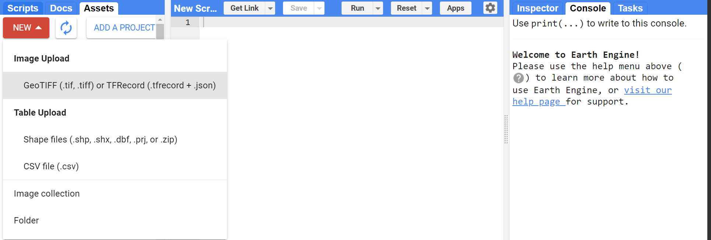

2. Clicking the  **New** button will list the acceptable file options, including **Raster** (Geotiffs or TFRecords), **Vector** (Shapefiles) and **Data tables** (CSV files), which will be described in the following subsections.

Uploading Vector Files
~~~~~~~~~~~~~~~~~~~~~~

.. Note::
   In SEPAL-SDG 15.4.2 ,custom country boundaries need to be uploaded in vector format.

1.  In the **Earth Engine Code Editor**, click **New** and select **Shapefiles** to upload a custom country boundary in vector format. 

2. In the pop-up window, select the file you want to upload from your computer. Compatible formats include :code:`.shp`, :code:`.zip`, :code:`.dbf`, :code:`.prj`, :code:`.shx`, :code:`.cpg`, :code:`.fix`, :code:`.qix`, :code:`.sbn` or :code:`.shp.xml`; if you didn't compress the file, a :code:`.shp` alone is not sufficient and must be accompanied with other files describing the shape as in the example in the image below :

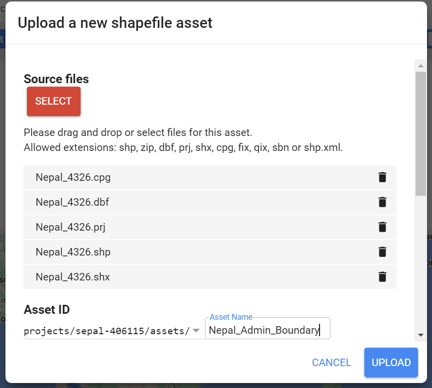

Any file errors will be highlighted by the uploader, as in the example below:

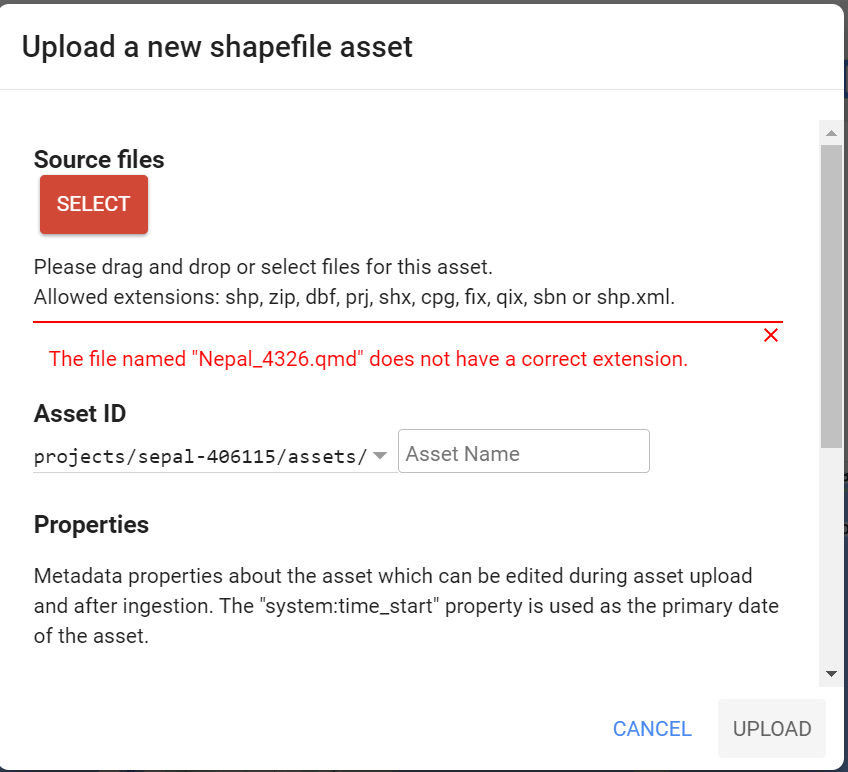

3. Once all files are loaded correctly, the upload progress is displayed in the task manager. Typically this process takes a couple of minutes depending on the size of the dataset. The progress of the upload is displayed in the task manager as shown below:

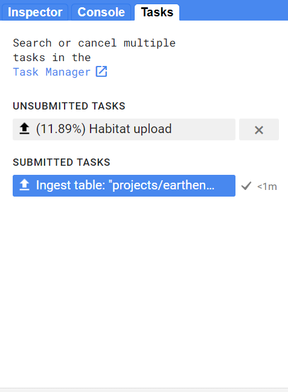

4. Once completed,the uploaded assets will be listed in the Assets List under the Assets tab. If not displayed, click on the **Refresh** button.

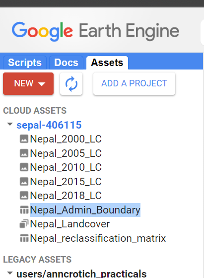

5. Clicking on the asset will open an asset details window ; The asset is ready for use. You can now visualize, share or delete it accordingly.

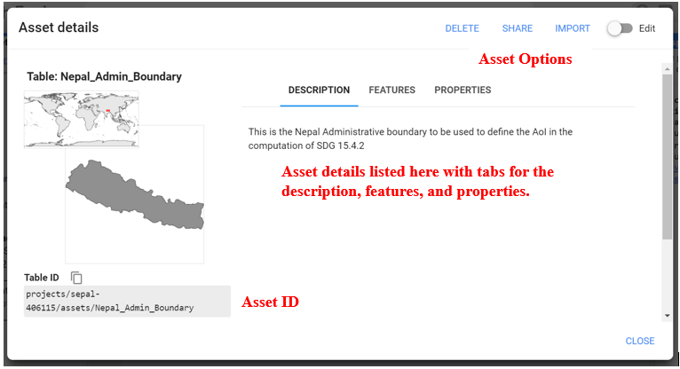

Uploading Raster Files
~~~~~~~~~~~~~~~~~~~~~~~

When computing SDG 15.4.2, land cover maps are uploaded as raster files , made available as `image collections <https://developers.google.com/earth-engine/guides/ic_creating>`_ to be usable in SEPAL-SDG 15.4.2 . 

1. To upload the rasters, select **New > Image Upload**.

2. In the pop-up window, select the raster file (compatible formats include :code:`.tiff`, :code:`.tif`, :code:`.json`, :code:`.tfrecord` or :code:`.tfrecord.gz`. By default, the asset will be named after the basename; the name of your asset can be changed in the text field. When naming, it is good practice to include the reference year of the land cover map.

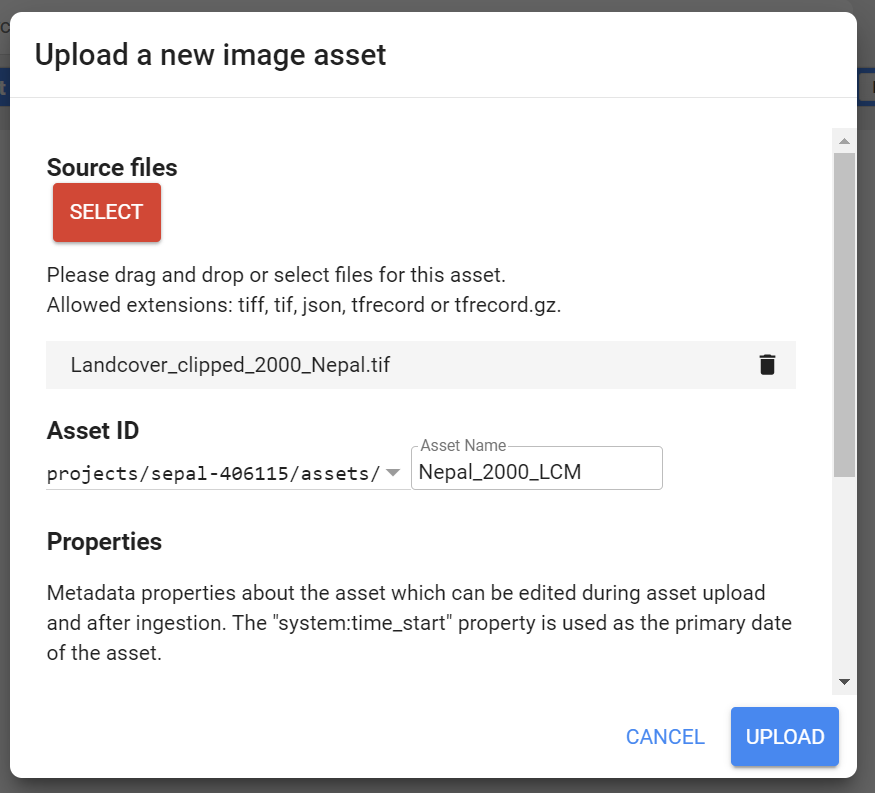

3. Repeat step 2 for each of the land cover maps.

Creating an Image Collection
~~~~~~~~~~~~~~~~~~~~~~~~~~~~

An image collection is a stack or sequence of images ,typically used to organize vast datasets like Landsat or MODIS, allowing you to filter, process, and analyze large quantities of geospatial data simultaneously across large areas and timeframes.

To create an Image Collection;

1. Click on the **Assets Tab** and then New > **Image collection.**

2. This will open the image collection constructor that will prompt you to name your image collection as shown below:

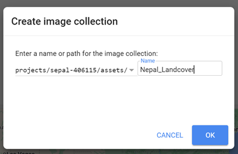

3. Once the image collection is created, you can load it by pasting an Earth Engine asset ID into the Image Collection constructor (Ensure the **Edit** button is on) or by simply dragging individual assets to the image collection in the assets list as shown below:

4. Repeat this for each asset. Clicking on the Image Collection (in the asset list) should now show all the images that are contained in that collection and should now be ready to be used in your analysis or visualization.

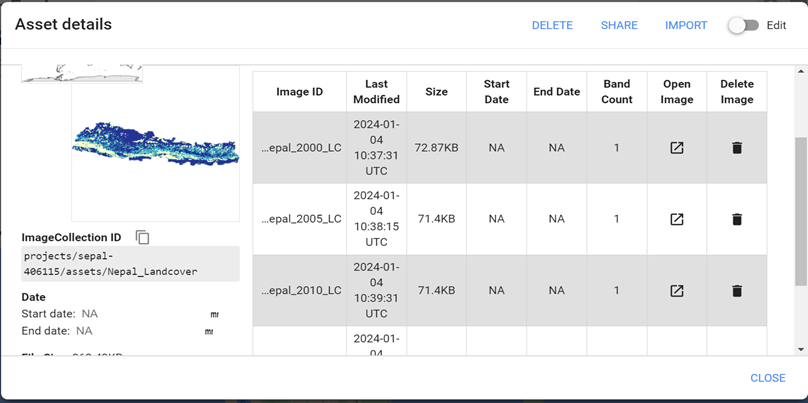

Uploading  Tabular Files
~~~~~~~~~~~~~~~~~~~~~~~~
Tabular data can be uploaded into Google Earth Engine as comma-separated values (CSV) or Javascript Object Notation (JSON) files :code:`.csv`, or :code:`.json`). To upload tabular files:

1. Select New > **csv file upload**. 
2. In the pop-up window that appears, select the file you want to upload from your computer 

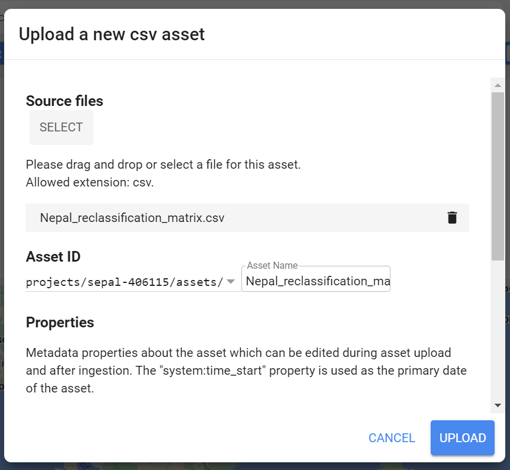

.. tip::
   Once uploaded in GEE , and the connection between the two accounts established , the assets are available and accessible from SEPAL. They can be selected from the dropdown or  by pasting the assets ID directly from GEE when prompted in SEPAL-SDG 15.4.2 .

.. _Vector_File_Manager:

Uploading Vector Files into SEPAL via the Vector File Manager.
~~~~~~~~~~~~~~~~~~~~~~~~~~~~~~~~~~~~~~~~~~~~~~~~~~~~~~~~~~~~~~

Apart from Google Earth Engine,you can directly upload your tabular datasets ( vector or CSV tables) into the SEPAL environment through the Vector File Manager.Find more information on the `Vector File Manager here <https://docs.sepal.io/en/latest/modules/dwn/vector_manager.html>`_.

1. Navigate to the **Apps** tab (located on the left of the SEPAL interface) and find the **Vector File Manager** by either navigating through the app list or using the search bar.
2. Clicking on the app opens the vector file manager as shown below:
   
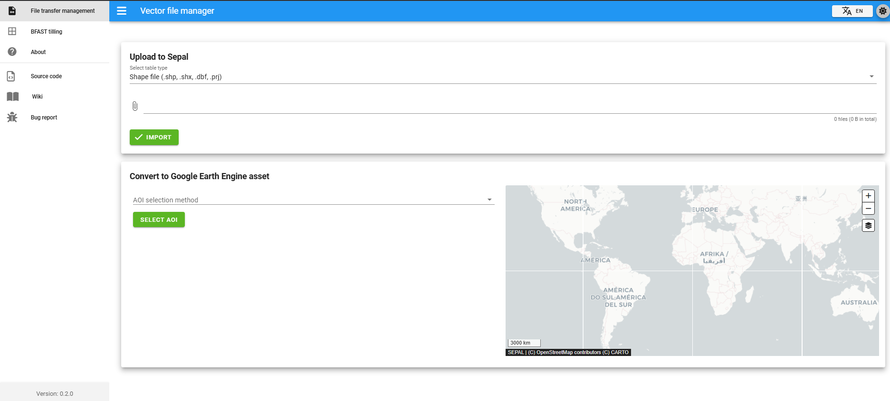

3. Clicking on the drop down arrow allows you to select the table type.(Accepted formats are shapefiles :code:`.shp` and table file :code:`.csv`)
4. Choose the shapefile option and click on the :code:`📎` icon to navigate to your files and choose all appropriate files and click :guilabel:`Import`.
    
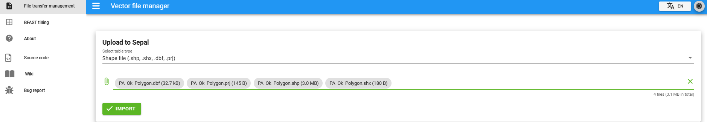

The process is same for tables :

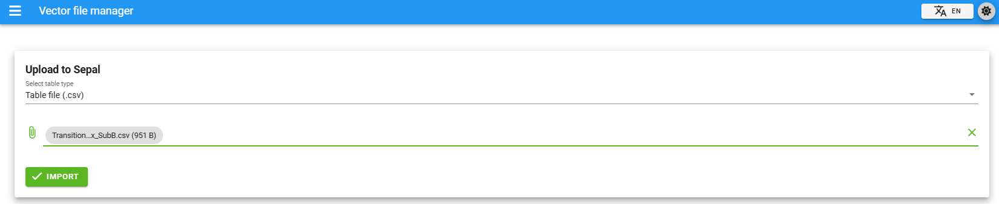

5. The vector file manager notifies you when the importation is complete.
   
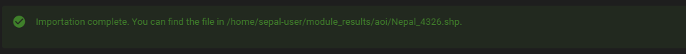

6. To locate the uploaded files, click on the Module_Results > AOI in the Home page:
   
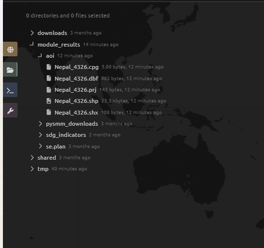

.. seealso:: The methods explained above should suffice for our case. However,since SEPAL’s built-in tools for uploading and downloading are limited, large amounts of data should be uploaded or downloaded using an FTP solution.More on this can be found `here <https://docs.sepal.io/en/latest/setup/filezilla.html#>`_.

